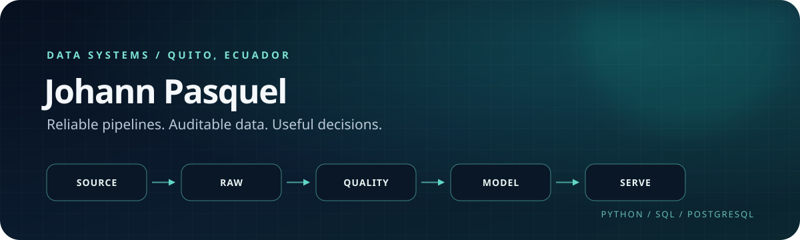

<p align="center">
  
</p>

<p align="center">
  <a href="https://vladimirjon.github.io/JohannPasquel_PersonalWebsite/"></a>
  <a href="https://www.linkedin.com/in/johannpasquel/"></a>
  <a href="mailto:johannpasquel@gmail.com"></a>
</p>

I build reliable data systems with a backend engineer's attention to integrity, traceability, and operational behavior. My work connects source data, immutable evidence, relational models, APIs, automation, and analytics.

I am a Computer Science Engineering student at **Escuela Politécnica Nacional** in Quito, Ecuador. My current focus is data engineering with **Python, SQL, PostgreSQL, data quality, batch processing, and analytics engineering**.

## Selected work

### [Ecuador Public Procurement Data Quality Monitor](https://github.com/Vladimirjon/ec-public-procurement-quality-monitor)

An auditable foundation for assessing Ecuadorian public procurement data while preserving the source evidence behind every result.

**Implemented:** content-addressed raw storage, SHA-256 integrity checks, typed SERCOP source access, PostgreSQL persistence, checksum-verified migrations, append-only audit rules, and automated tests.

**Current status:** architecture and initial development. The end-to-end ingestion and quality flow is not implemented yet.

`Python` `PostgreSQL` `httpx` `psycopg` `Docker` `GitHub Actions`

---

### [Computer Vision Game Reconstruction](https://github.com/Vladimirjon/Captura_automatica_de_posiciones_con_AI_Vision)

End-to-end computer vision system that detects pieces, corrects perspective, reconstructs an Amazons board, validates moves, and tracks match state in real time.

YOLOv8-nano reached **99.38% precision, 100% recall, 99.50% mAP50**, and **26.2 ms inference time per image**.

`Python` `YOLOv8` `OpenCV` `Roboflow`

---

### [Distributed Identity & High Availability](https://github.com/Vladimirjon/PasquelJ-MiniIdM)

Identity architecture deployed across three Linux virtual machines with replicated OpenLDAP, redundant Kerberos, PKI/TLS, HAProxy, and Keepalived. Controlled failure tests maintained **12/12 successful requests**.

`Linux` `OpenLDAP` `Kerberos` `HAProxy` `Keepalived` `PKI/TLS`

## Engineering focus

```text
source -> raw evidence -> validation -> relational storage -> transformation -> analytics
```

- **Data systems:** Python, SQL, PostgreSQL, MySQL, SQL Server, data quality, relational modeling
- **Analytics:** Power BI, Power Query, DAX, reproducible reporting
- **Backend & automation:** TypeScript, PHP, REST APIs, n8n, Power Automate
- **Infrastructure:** Docker, Linux, GitHub Actions, Apache

## Experience highlights

- Built institutional backend modules and academic reporting flows with NestJS, TypeORM, MySQL, JWT, and Next.js.
- Restored and validated a Linux-based institutional data-processing environment using Apache, Python, ODBC, and SQL Server.
- Developed an offline-capable technical-reporting product with immutable report history, append-only audit records, automated document generation, and CI workflows.
- Placed **3rd in Ecuador at IEEEXtreme 19.0** with Team Kiubit.

## Currently building

- An auditable public-procurement data-quality workflow
- Batch ingestion and PostgreSQL persistence patterns
- A dimensional public-procurement warehouse as an academic team project
- Stronger data profiling, validation, and analytics practices

<p align="center">
  <strong>Open to internships and junior opportunities in data engineering, analytics engineering, and backend data systems.</strong>
</p>

<p align="center">
  <a href="https://vladimirjon.github.io/JohannPasquel_PersonalWebsite/">Portfolio</a>
  &nbsp;&middot;&nbsp;
  <a href="https://github.com/Vladimirjon">GitHub</a>
  &nbsp;&middot;&nbsp;
  <a href="https://www.linkedin.com/in/johannpasquel/">LinkedIn</a>
</p>
